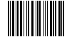
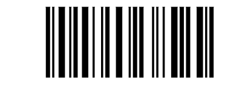
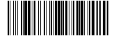

# Barcodes

[](https://github.com/rmsrosa/Barcodes.jl/actions/workflows/CI.yml)
[](https://rmsrosa.github.io/Barcodes.jl/dev/)
[](https://opensource.org/licenses/MIT) 


A pure-Julia [Code128](https://en.wikipedia.org/wiki/Code_128) barcode generator.

*This package is under development and is not yet registered.*

Currently, only [Code128](https://en.wikipedia.org/wiki/Code_128) is implemented, including the extended (Latin-1) characters and the [GS1-128](#gs1-128) variant. For other barcodes, see [Related packages](#related-packages). 

The documentation, with a manual and the list of functions, is at <https://rmsrosa.github.io/Barcodes.jl/dev/>. The examples below are a quick tour. For more detailed information on [Code128](https://en.wikipedia.org/wiki/Code_128), see [The 128 code](http://grandzebu.net/informatique/codbar-en/code128.htm) and [How Barcodes Work](https://courses.cs.washington.edu/courses/cse370/01au/minirproject/BarcodeBattlers/barcodes.html)

## Methods

The main encoding methods are 

* `encode(msg::AbstractString, encoding_type::Symbol)`: yields a symbolic encoding for the given `msg`, in the form of a `Vector{String}`, according to the given `encoding_type`;
* `barcode_pattern(code::Vector{<:AbstractString}, encoding_type::Symbol)`: yields the barcode pattern for the given `code` (usually obtained from `encode()`), in the form of a `String` with 0's and 1's representing a space or a bar, according to the given `encoding_type`;
* `barcode_pattern(msg::AbstractString, encoding_type::Symbol)`: yields the codebar pattern directly from the `msg` (this simply calls the previous two methods), according to the given `encoding_type`.
* `barcode_img(pattern::String; img_height = 50)`: yields a `Gray` type barcode image associated with the given pattern.

The main decoding methods are
* `decode(code::Vector{String}, encoding_type::Symbol)`: yields the message encoded in `code`, according to the given `encoding_type`;
* `barcode_depattern(pattern::AbstractString, encoding_type::Symbol)`: yields the `code` associated with the given barcode pattern `pattern`, according to the given `encoding_type`;
* `barcode_decode(pattern::AbstractString, encoding_type::Symbol)`: yields the message encoded in the given barcode pattern `pattern`, according to the given `encoding_type`.

The main encoding type is `:code128`. When encoding, it is also possible to set the `encoding_type` to `:code128a`, `:code128b`, or `:code128c`, following the subtypes Code128A, Code128B or Code128C, respectively, or to `:gs1128` for a [GS1-128](#gs1-128).

If `:code128` is given, the method chooses the code sets (A, B, and C) and where to switch between them so that the barcode has the minimal number of symbols, and the same happens in `:gs1128`.

## Examples

### Zip code barcode

Here is an example with a ZIP code:

```julia
julia> using Barcodes

julia> zip_code = "12.345-678"
"12.345-678"

julia> zip_code = replace(zip_code, r"\s|\.|\-" => "")
"12345678"

julia> pattern = Barcodes.barcode_pattern(zip_code, :code128)
"00000000000110100111001011001110010001011000111000101101100001010010001110110110001110101100000000000"
```

One can see the code with `encode`:

```julia
julia> code = Barcodes.encode(zip_code, :code128)
7-element Vector{String}:
 "START C"
 "12"
 "34"
 "56"
 "78"
 "CHECKSUM 47"
 "STOP"
```

Once the `pattern` is obtained, one can create a Gray Image with `barcode_img(pattern::String; img_height = 50)`. After that, you can save it with `FileIO`.

```julia
julia> using FileIO

julia> img = Barcodes.barcode_img(pattern)

julia> FileIO.save("img/zipcode_img.png", img)
```

Here is the result of saving the zip code above to a PNG file:



With [JuliaImages](https://juliaimages.org/stable/), one can resize the generated image as desired.

One can also plot the barcode with `Plots`, using the utility function `Barcodes.barcode_positions(pattern)`, which yields the locations (indices) of each solid bar and their width:

```julia
julia> using Plots

julia> x, w = Barcodes.barcode_positions(pattern)
([12, 15, 18, 23, 25, 29, 34, 38, 40, 45  …  56, 62, 64, 67, 71, 75, 78, 83, 87, 89], [2, 1, 3, 1, 2, 3, 1, 1, 2, 3  …  2, 1, 1, 1, 3, 2, 2, 3, 1, 2])

julia> plot([x'; x' + w'], ones(2, length(x)), color = :black, fill = true, xlims = (1, length(pattern)),  ylims = (0, 1), border = :none, legend = nothing)
```

Here is the resulting image:



One can decode it directly from the pattern or from the code, with

```julia
julia> code_back = Barcodes.barcode_depattern(pattern, :code128)
7-element Vector{String}:
 "START C"
 "12"
 "34"
 "56"
 "78"
 "CHECKSUM 47"
 "STOP"

julia> msg_back1 = Barcodes.decode(code_back, :code128) # from the depatterned code
"12345678"

julia> msg_back2 = Barcodes.barcode_decode(pattern, :code128) # directly from pattern
"12345678"
```

Another representation of the barcode is with the widths of the bars and of the spaces between bars. The `START C` code pattern `11010011100`, for instance, can also be represented by `211232`, which are the widths of each bar and each space, with the correspondance `11 => 2`, `0 => 1`, `1 => 1`, `00 => 2`, `111 => 3`, `00 => 2`. Each symbol pattern always starts with `1`, ends with `0` (apart from the final bar that follows the `STOP` symbol), and has exactly three bars and three spaces. We can get this alternative representation for the barcode with the method `barcode_widths(pattern::AbstractString)`.

```julia
julia> Barcodes.barcode_widths(pattern)
"211232112232131123331121241112133121233111"
```

### Barcode social preview image for Barcodes.jl

The image for the github social preview of this package was created from the barcode for "Barcodes.jl", with

```julia
julia> msg = "Barcodes.jl"
"Barcodes.jl"

julia> pattern = Barcodes.barcode_pattern(msg, :code128)
"0000000000011010010000100010110001001011000010010011110100001011001000111101010000100110101100100001011110010010011001110100001100101100101000010001001100110001110101100000000000"

julia> x, w = Barcodes.barcode_positions(pattern)
([12, 15, 18, 23, 27, 29, 34, 37, 39, 45  …  133, 137, 139, 144, 148, 151, 155, 160, 164, 166], [2, 1, 1, 1, 1, 2, 1, 1, 2, 1  …  2, 1, 1, 1, 1, 2, 2, 3, 1, 2])

julia> plot([x'; x' + w'], ones(2, length(x)), color = :black, fill = true, xlims = (1, length(pattern)),  ylims = (0, 1), border = :none, legend = nothing, size = (896, 448))

julia> savefig("img/barcodesjl.svg")
```

We save the barcode plot to `SVG` and added the text and extra margins with [Inkspace](https://inkscape.org), adjusting the size to 1280 x 640.

### Mixed subtypes

Here is another example, with mixed subtypes:

```julia
julia> msg = "\x02abc1234\x03"
"\x02abc1234\x03"

julia> println(msg)
abc1234

julia> code = Barcodes.encode(msg, :code128)
13-element Vector{String}:
 "START A"
 "STX"
 "CODE B"
 "a"
 "b"
 "c"
 "CODE C"
 "12"
 "34"
 "CODE A"
 "ETX"
 "CHECKSUM 87"
 "STOP"

julia> pattern = Barcodes.barcode_pattern(code, :code128)
"00000000000110100001001001000011010111101110100101100001001000011010000101100101110111101011001110010001011000111010111101000010110011110010100110001110101100000000000"

julia> img = Barcodes.barcode_img(pattern)

julia> FileIO.save("img/abc1234.png", img)
```



### A Code128 type

The `Code128` type stores a barcode as the vector of the integer values (from 0 to 106) of its symbols, `[START, data..., CHECKSUM, STOP]`, which is what enters the checksum and what is converted to bar patterns. The names of the symbols, such as `"START C"` or `"SHIFT B"`, are only used for display and for the interface based on vectors of strings (`encode`, `decode`, `barcode_pattern`, ...).

A `Code128` can be created from a message (a `String`), from a code (a `Vector{String}`, as returned by `encode`), or from the values of the symbols (a vector of integers). When created from a message, with the default `:code128` encoding type, the code sets (A, B, C) and the SHIFT and CODE symbols are chosen so that the barcode has the minimal number of symbols, following the conventions of the GS1 General Specifications when there is more than one way to do it.

The message can have any character of ISO/IEC 8859-1 (Latin-1), that is, with code points up to `U+00FF`. The characters above `U+007F` are encoded with the directive FNC4, either a single one before each such character, or two in a row to switch an extended mode on (and, later, off), whichever gives the shortest barcode:

```julia
julia> Barcodes.encode("Héllo", :code128)
9-element Vector{String}:
 "START B"
 "H"
 "FNC 4"
 "i"
 "l"
 "l"
 "o"
 "CHECKSUM 73"
 "STOP"
```

Not all scanners support FNC4: some read `"Héllo"` as `"Hillo"`, ignoring the directive.

The properties of the barcode are obtained with the functions `Barcodes.message`, `Barcodes.subtype`, `Barcodes.codenames`, `Barcodes.checksum`, `Barcodes.isgs1128`, and `Barcodes.barcode_pattern`. The `show` method is extended for a better visualization of the barcode content. Unicode blocks are used for a simple view of the code bars.

```julia
julia> Barcodes.Code128("12345678")
Code128: 12345678

     ▐▌▌▐█ ▌█ █▌▐ ▐▐▌ █▌ ▌█▐▌ ▐▐ ▌ █▌█▐▌ █▌▌█      


julia> show(IOContext(stdout, :detailed => true), MIME("text/plain"), Barcodes.Code128("1234567"))
Barcode type: Code128
Message: 1234567
Code:
        START C
        12
        34
        56
        CODE B
        7
        CHECKSUM 44
        STOP
Barcode pattern:
     ▐▌▌▐█ ▌█ █▌▐ ▐▐▌ █▌ ▌█▐▐█▌█▌█▌█▐█▐ ▐▌█▌█ ▐█▐▐▌     

```

### GS1-128

A [GS1-128](https://www.gs1.org/standards/barcodes/application-identifiers) is a Code128 with the function character FNC1 right after the START symbol, and with the data organized in element strings, each one being an Application Identifier (AI) followed by its data. Use the encoding type `:gs1128`, and the FNC1 symbols, including the separators after the fields of variable length, are added for you:

```julia
julia> Barcodes.encode("(01)09501101530003", :gs1128)
12-element Vector{String}:
 "START C"
 "FNC 1"
 "01"
 "09"
 "50"
 "11"
 "01"
 "53"
 "00"
 "03"
 "CHECKSUM 71"
 "STOP"

julia> Barcodes.gs1_element_string("(10)ABC123(21)XYZ")
"10ABC123\x1d21XYZ"
```

The message can be in the human readable form, with the AIs between parentheses, or the concatenation of the element strings, with the character GS (`'\x1d'`) as the separator, which is also what `decode` returns. There is no table of all the AIs: only the ones with a predefined length are known, and the data is not validated. See the [documentation](https://rmsrosa.github.io/Barcodes.jl/dev/manual/#GS1-128) for the details.

## Related packages

This package is a pure Julia package initiated in 2021 and, so far, limited to Code128. There is now the barcode package [`ZXingCPP.jl`](https://github.com/rakeshksr/ZXingCPP.jl), created in 2025, which is a wrapper for the fairly complete C++ library [`zxing-cpp`](https://github.com/zxing-cpp/zxing-cpp). It seems to be well integrated with [Images.jl](https://github.com/JuliaImages/Images.jl) and [OpenCV.jl](https://github.com/JuliaImages/OpenCV.jl).

Specifically for QR codes, there is also the package [`QRCoders.jl`](https://juliaimages.org/QRCoders.jl/dev/). 

## License

This package is provided under the [MIT License](LICENSE).